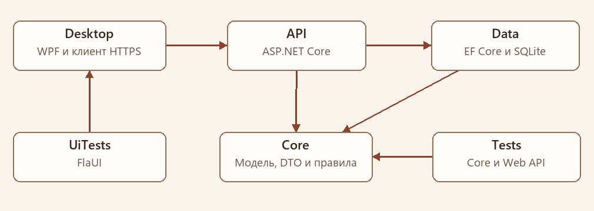
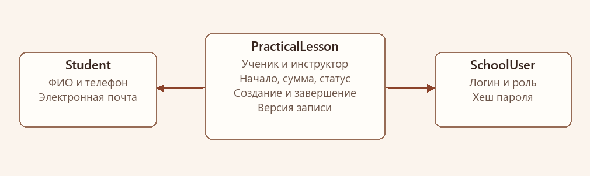
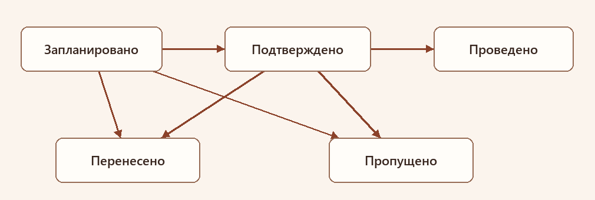

# Архитектура

Desktop запускает API внутри процесса и обращается к нему по HTTPS на loopback. API можно запустить самостоятельно. Контроллер извлекает роль и идентификатор из валидированного JWT и передаёт их репозиторию. Data применяет область видимости до проекции результата. Core хранит сущности, контракты и переходы, его можно проверять без базы и UI.

Практическое занятие принадлежит одному ученику и может быть назначено одному инструктору. Роль и логин входят в отдельную сущность пользователя. Версия занятия защищает от потери изменений при двух редактированиях. Время запланированного начала хранится со смещением, фактическое завершение и создание — в UTC. Средний срок считается в календарных днях от создания до фактического завершения только для проведённых занятий.

Операционный путь подтверждения: диалог → SchoolClient → POST /api/lessons/{id}/transition → SchoolStore → LessonRules → SQLite → обновление WPF.
